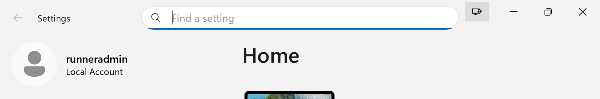
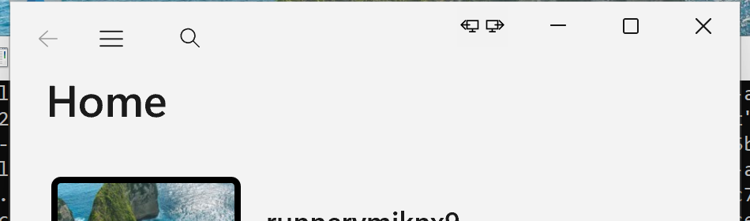

# MoveToMonitorButton

**使いたい画面へ、タイトルバーからワンクリック。**

[English](README.md) · **日本語**

[**Windows版をダウンロード**](https://github.com/imksoo/add-move-display-button/releases/latest) · [不具合を報告](https://github.com/imksoo/add-move-display-button/issues)

ブラウザーの隣に資料を置く。チャットをサブモニターへ移す。最大化したアプリを、別の画面で使い続ける。MoveToMonitorButtonは、ウィンドウの既存の操作ボタンの隣に、小さな「別モニターへ移動」ボタンを追加します。

*2画面用の1ボタン表示。Windows設定を200%表示した実際の画面です。最小化ボタンの左にある「モニターと矢印」が、追加された移動ボタンです。*

## いつもの場所から、画面を移動

| やりたいこと | 操作・動作 |
|---|---|
| 2画面で切り替える | 追加された1つのボタンを左クリック。 |
| 3画面以上で前後へ移す | 左のボタンで前の番号、右で次の番号へ。端では循環。 |
| 移動先を確認する | ボタンにマウスを重ねると「画面 N へ移動」を表示。 |
| 移動先を選ぶ | 追加ボタンを右クリックし、モニターを選択。 |
| 最大化したまま移す | 一度復元して移動し、移動先で再び最大化。 |
| 背景のウィンドウを操作する | 見えているタイトルバーにもボタンを表示。マウスを乗せただけでは前面に出しません。 |
| Windowsへのサインイン後も使う | トレイメニューで自動起動をオンに。 |

- **目で見て使えるショートカット。** 移したいウィンドウのそばに操作ボタンがあります。
- **インストール不要。** EXEをダウンロードして起動するだけです。
- **独自タイトルバーやHiDPIにも対応。** 対応可能なウィンドウを検出し、表示倍率を考慮して配置します。
- **無料・オープンソース。** MITライセンス。このユーティリティ用のアカウント登録は不要です。

## 3画面以上でも、番号で迷わず移動

3画面以上では**「前へ」「次へ」の2ボタン**になります。画面の左右の配置ではなく、画面番号の昇順で移動します。2画面では両方向の移動先が同じなので1ボタンです。

*3画面以上で使う2ボタン表示です。左が前の番号、右が次の番号へ移動します。Windows設定の実画面を200%表示し、1画面の試験環境で表示プレビューを使って撮影しました。ボタンの見た目を示す画像で、物理的な3台のモニターを撮影したものではありません。[撮影元](docs/images/README.md)。*

| 今いる画面 | 左のボタン（前） | 右のボタン（次） |
|---|---|---|
| 1 | 3 | 2 |
| 2 | 1 | 3 |
| 3 | 2 | 1 |

タイトルバーの余白が狭い場合は、縦位置を保って2ボタンの幅を小さくします。両方を安全に置けない場合は、トレイメニューから移動できます。

番号が1・3・5なら、その順で循環します。接続解除や表示モード変更後は、現在使える拡張デスクトップだけが移動先になります。

番号はWindowsのディスプレイ情報から自動取得します。ただしドライバー・接続構成によって、Windows設定の「識別」と一致しない場合があります。その場合は追加ボタンを右クリック → **「画面番号をWindowsに合わせる…」** → **「このウィンドウの画面」**が付いた項目で、Windowsの「識別」に出る番号を選んでください。補正は保存され、前後移動・移動先メニュー・ツールチップすべてに反映されます。既存の番号を選ぶと入れ替わります。Windows側の設定は変更しません。

## 独自タイトルバーを使うアプリにも

新しいChatGPTデスクトップアプリなどにもボタンを追加できます。アプリ名の一覧で限定せず、ウィンドウの機能とタイトルバーの当たり判定から対象・配置を決めます。

*ChatGPTを150%表示した、未ログイン時のタイトルバーです。既存の操作ボタンの左に移動ボタンが並びます。*

配置先がウィンドウをドラッグできる領域か確認し、適切な余白を確認できない場合は非表示にします。独自フレームの構造、タイトルバーの空き、管理者権限の違いによって、表示・操作できないアプリもあります。

## 使い始める

1. モニターを2台以上接続し、Windowsの表示モードを**「拡張」**にします。1画面では既定でボタンを表示しません。
2. [Releases](https://github.com/imksoo/add-move-display-button/releases/latest)から`MoveToMonitorButton.exe`をダウンロードするか、ポータブルZIPを展開します。
3. EXEを使い続けるフォルダーに置き、通常権限で起動します。
4. 追加ボタンでウィンドウを移動できます。通知領域のトレイアイコンを右クリックすると、自動起動・一時停止・表示診断・終了を選べます。

配布物は**x64版EXE**です。同じEXEを、**Windows 11 Armのx64エミュレーション環境**でも検査しています。

### 表示言語を選ぶ

初期状態ではWindowsの表示言語に従い、日本語のWindowsでは日本語、それ以外では英語で表示します。トレイアイコンを右クリック → **言語 / Language** → **日本語**または**English**で、メニュー・ツールチップ・表示診断・通知をすぐに切り替えられます。選択は現在のユーザーに保存され、再起動後も維持します。**「Windowsの表示言語に合わせる」**で自動選択に戻せます。

### Windowsと一緒に起動する

トレイアイコンを右クリックし、**「Windowsへのサインイン時に起動」**を選びます。初期状態はオフで、現在のユーザーだけに適用します。もう一度選ぶと登録を解除します。

EXEを移動・削除する前にオフにしてください。移動した場合は新しい場所で再登録します。Windowsの**「設定 → アプリ → スタートアップ」**で無効にした場合は、そちらも確認してください。

### 更新・削除する

更新するときは、旧版のトレイメニューから**「終了」**を選んでからEXEを入れ替えます。削除するときは、自動起動をオフにし、終了してからEXEを削除してください。

## 対応状況と確認範囲

Windows設定とChatGPTのタイトルバーは、1ボタン・2ボタンの両方を**100%・150%・200%**の表示倍率で、通常・最大化・復元後の状態を検査します。Explorer、メモ帳、Chrome、Microsoft Store、電卓などの実アプリも検査しています。対象アプリのバージョンと結果は[GitHub Actions](https://github.com/imksoo/add-move-display-button/actions/workflows/real-apps.yml)に記録します。

使い捨てのWindows環境で実アプリを動かした検査です。ChatGPTは未ログイン状態を対象とします。実際の複数モニター間での混在DPI切替や、各アプリのすべての画面構成をCIで確認したものではありません。

他アプリへのDLL注入やネットワーク通信は行いません。画像・ウィンドウタイトル・ファイル名を保存／送信しません。EXEは現在未署名です。

[ソースのビルドと検査（英語）](docs/DEVELOPMENT.md) · [設計説明](docs/ARCHITECTURE.md) · [MITライセンス](LICENSE)
