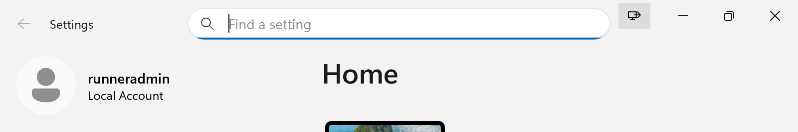
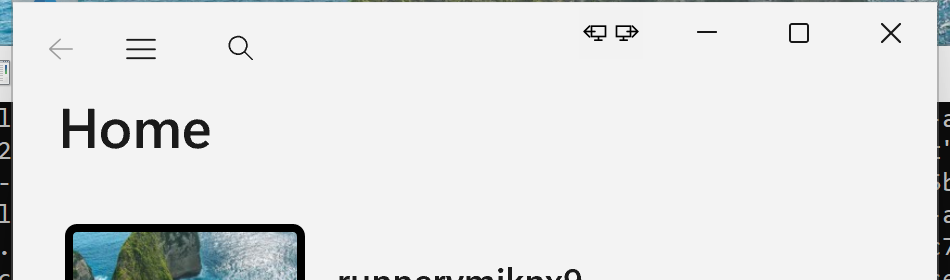

# MoveToMonitorButton

**Move a window to another display with one click from its title bar.**

**English** · [日本語](README.ja.md)

[**Download for Windows**](https://github.com/imksoo/add-move-display-button/releases/latest) · [Report a problem](https://github.com/imksoo/add-move-display-button/issues)

Working across two or more monitors? Keep a document beside your browser, move a chat window to your secondary display, or move a maximized app without dragging it across your desktop. MoveToMonitorButton adds a small monitor-and-arrow button beside a window's existing controls.

*Single-button layout for two displays. Windows Settings at 200% scaling. The monitor-and-arrow icon to the left of Minimize is the added button. This is a capture of the actual Windows application.*

## A familiar place for one more useful action

| What you want to do | How it works |
|---|---|
| Switch between two displays | Left-click the single added button. |
| Navigate three or more displays | Use the left button for the previous number, or the right button for the next. Both wrap around. |
| Check the destination | Hover to see the destination display number. |
| Choose a specific display | Right-click the button and select a destination. |
| Move a maximized window | The app restores it, moves it, and maximizes it again. |
| Work with a window in the background | Visible, unobstructed title bars can show their own button. Hovering does not bring the window to the front. |
| Keep it ready after signing in | Turn on the optional Windows sign-in startup setting in the tray menu. |

- **A visible shortcut:** the control stays with the window you want to move.
- **Portable:** download one EXE and run it. No installer is required.
- **Fits modern desktops:** supports standard title bars and compatible custom frames; placement accounts for display scaling.
- **Free and open source:** MIT licensed, with no account required by this utility.

## Previous and next, in display-number order

With **three or more extended displays**, two buttons appear: previous number and next number. With two displays, one button is enough because both directions lead to the same destination. Movement follows ascending display numbers, independently of their physical left-to-right arrangement.

*The two-button layout used with three or more displays: left = previous number, right = next. Actual Windows Settings at 200% scaling, captured with the layout-preview option on a single-display test desktop. This image shows the button appearance; it is not a photograph of a physical triple-monitor setup. [Capture source](docs/images/README.md).*

| Current display | Left button: previous | Right button: next |
|---|---|---|
| 1 | 3 | 2 |
| 2 | 1 | 3 |
| 3 | 2 | 1 |

Where title-bar space is narrow, the pair uses compact widths while keeping the same vertical center. If a safe region cannot be verified for both buttons, use the tray menu.

Gaps are preserved: displays 1, 3, and 5 cycle in that order. Disconnected and disabled desktops are excluded after a topology refresh.

Automatic numbering uses Windows display information, but some drivers and configurations differ from Settings → Display → Identify. To match those systems, right-click a button → **Match Windows display numbers…**, select the item marked **this window's display**, and choose the number shown by Windows Identify. The correction persists and applies to both buttons, destination menus, and tooltips. Choosing a number already in use swaps the two. This changes only the utility's labels, not Windows settings.

## Works with compatible custom title bars

The button can also appear on apps such as the new ChatGPT desktop app. Detection uses window capabilities and caption hit-testing, rather than a list of application names.

*ChatGPT at 150% scaling. Actual title-bar capture from the app before sign-in; the move button sits to the left of its existing controls.*

The app checks for space where the window reports a draggable title bar. If it cannot confirm a suitable area, it leaves the button hidden. Custom frames, crowded title bars, and apps running with higher privileges can limit availability.

## Get started

1. Use **Extend** display mode with at least two monitors. The button is hidden on a single-monitor desktop by default.
2. Download `MoveToMonitorButton.exe`, or extract the portable ZIP, from [Releases](https://github.com/imksoo/add-move-display-button/releases/latest).
3. Put the EXE in a folder you intend to keep and run it with normal user permissions.
4. Use the added button to move windows. Right-click the notification-area icon for startup, pause, diagnostics, and exit.

The download is an **x64 EXE**. That same executable is also tested on **Windows 11 Arm** under x64 emulation. Menus, tooltips, diagnostics, and notifications support English and Japanese.

### Choose a language

The app follows your Windows display language by default: Japanese for Japanese Windows, English otherwise. Right-click the tray icon → **Language / 言語** → **English** or **日本語** to switch immediately. Your choice is saved for the current user and survives restarts. Select **Follow Windows display language** to return to automatic selection.

### Start with Windows

Right-click the tray icon and select **Start when signing in to Windows**. Startup is off by default and applies only to your current user. Select it again to remove the registration.

Before moving or deleting the EXE, turn startup off. If you move it, enable startup again from the new location. If Windows has disabled it under **Settings → Apps → Startup**, check that setting too.

### Update or remove

Choose **Exit** from the old version's tray menu before replacing it. To remove the utility, turn off its startup setting, exit it, and delete the EXE.

## Compatibility and transparency

Both the single and paired buttons on Windows Settings and ChatGPT are checked at **100%, 150%, and 200% scaling**, including normal, maximized, and restored windows. Other real-app checks include Explorer, Notepad, Chrome, Microsoft Store, and Calculator. The exact tested app versions and results are recorded in [GitHub Actions](https://github.com/imksoo/add-move-display-button/actions/workflows/real-apps.yml).

These tests cover real application windows on disposable desktops. ChatGPT is tested before sign-in. Physical moves between monitors with different DPI settings and every possible app layout are not covered by those CI checks.

The utility does not inject DLLs into other apps or make network requests. It does not save or transmit screenshots, window titles, or filenames. The EXE is currently unsigned.

[Build and test the source](docs/DEVELOPMENT.md) · [Architecture (Japanese)](docs/ARCHITECTURE.md) · [MIT License](LICENSE)
